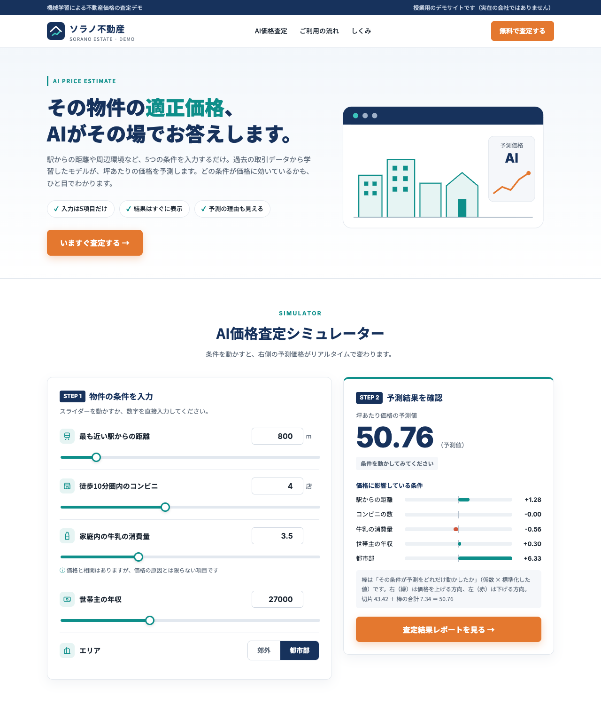
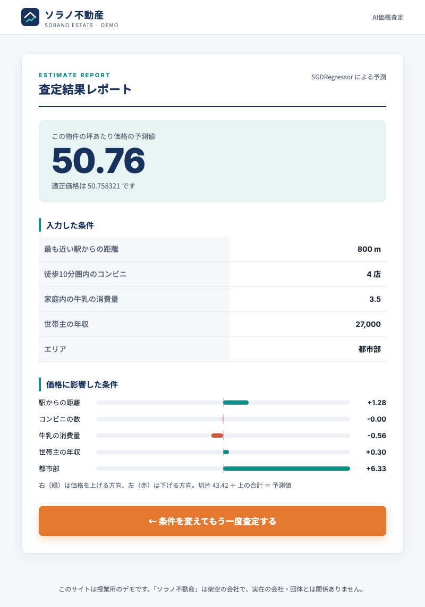
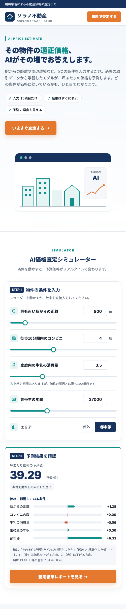

# demle-day8-real-estate-webapp

> 🌲 **このブランチ（`random-forest`）は、モデルをランダムフォレスト（`RandomForestRegressor`）に差し替えた版です。** 画面は `corporate-ui` と同じです。
>
> | | `main` / `rich-ui` / `corporate-ui` | `random-forest` |
> |---|---|---|
> | モデル | `SGDRegressor`（線形回帰） | `RandomForestRegressor`（決定木100本の平均、`max_depth=7`） |
> | 使う pickle | `model.pickle` ＋ `scaler.pickle` | **`model_v2.pickle` だけ** |
> | 標準化 | 必要（係数の大きさが値の単位に左右されるため） | **不要**（木は「年収が ○○ 以上か」のようにしきい値で分けるだけなので、単位が違っても結果が変わらない） |
> | 棒グラフ | 係数 × 標準化した値（切片 ＋ 合計 ＝ 予測値） | 木をたどったときの各分岐での変化を項目ごとに合計（学習データの平均 ＋ 合計 ＝ 予測値） |
> | 学習 | `python train.py` | `python train_v2.py`（Colab で作った `model_v2.pickle` を置いてもOK） |
>
> ```bash
> git clone -b random-forest https://github.com/sayo4869/demle-day8-real-estate-webapp.git webapp-rf
> # すでに clone してある人は： git switch random-forest
> python train_v2.py      # → model_v2.pickle（私の環境：学習 553 件 / テスト 139 件  MSE = 65.13）
> python -m uvicorn main:app --reload --port 8080
> ```
>
> - `model_v2.pickle` も `.gitignore` の `*.pickle` に含まれるので、コミットされません。
> - Colab で学習するときは、**DataFrame（列名 `X3, X4, X8, X9, X10`）のまま `fit`** してください。`main.py` も同じ列名の DataFrame で予測します。
> - ランダムフォレストには `partial_fit` がないので、`online_update.py`（オンライン学習）はこのブランチでは使えません。追加データを入れて学習し直してください。
> - EC2 では、`scp` で送るファイルが `model_v2.pickle` 1つになります。

> 🏢 **このブランチ（`corporate-ui`）は、白背景の「会社のサイト風」にした版です。** 機能は `rich-ui` ブランチと同じ（スライダーで動かすとその場で予測が変わる・寄与の棒グラフ）で、`templates/` のデザインだけが違います。
> 「ソラノ不動産」は授業用の**架空の会社**です。ロゴ・イラストもこのために作ったもので、実在の会社・団体とは関係ありません。
>
> | | `main` | `rich-ui` | `corporate-ui` |
> |---|---|---|---|
> | 見た目 | 講座と同じシンプルなフォーム | ダークテーマのダッシュボード風 | 白背景の会社サイト風（ヘッダー・ヒーロー・ご利用の流れ・フッター） |
> | 予測 | 送信すると結果ページ | 動かした瞬間に予測が変わる | 同左 |
> | 結果 | 「適正価格は ○○ です」 | 大きな数字・条件一覧・棒グラフ | 「査定結果レポート」形式 |
>
> ```bash
> git clone -b corporate-ui https://github.com/sayo4869/demle-day8-real-estate-webapp.git webapp-corp
> # すでに clone してある人は： git switch corporate-ui
> ```
>
> 
> 
> 
>
> 棒グラフの値は「係数 × 標準化した値」です。線形モデル（SGDRegressor）なので、**切片 ＋ 棒の合計 ＝ 予測値** になります。
> JavaScript が動かない環境でも、「結果ページで見る」ボタンで従来どおり予測できます。


**不動産価格を予測する機械学習モデルを、FastAPI の Web アプリにして Amazon EC2 にデプロイする**練習用のコードです。
データミックス DEMLE Day8「【実践編】不動産価格の予測モデルをデプロイしよう」の復習用に、自分で書き直しました。

```
ブラウザ ──(5つの値)──▶ main.py ──▶ scaler.pickle で標準化 ──▶ model.pickle で予測 ──▶ 「適正価格は ○○ です」
```

講座の配布コードから直したところ：

| 直したところ | 講座版 | このレポジトリ |
|---|---|---|
| 入力欄の名前 | `index.html` が `convini_num`、`main.py` が `conveni_num` で**つづりが違い、コンビニの数が常に0として予測されていた** | 両方 `conveni_num` にそろえた（コンビニ数を変えると予測が変わることを確認済み） |
| モデルの作り方 | Colab のノートブックで学習して pickle をダウンロード → git で運ぶ | `train.py` 1本で学習。**EC2の上で学習**するので、scikit-learn のバージョン違いで pickle が読めない問題が起きない |
| 宿題（オンライン学習） | MSE を別々のテストデータで比べていた | `online_update.py` で**同じテストデータ**の前後を比較 |
| pickle がないとき | 起動時に分かりにくいエラー | 「先に train.py を実行して」と表示して止まる |

---

## 公開してよい情報 / 公開してはいけない情報

このレポジトリは **public** です。

| 区分 | 中身 | このレポジトリ |
|---|---|---|
| ✅ 公開OK | 自分で書き直したコード（`main.py`、`templates/`、`train.py`、`online_update.py`）、README、`requirements.txt` | 入れている |
| ❌ 公開NG | **講座の配布データ**（`real_estate.zip` の CSV）。講座で列が付け足されていて、配布物は「無断複製・転載・配布禁止」 | 入れない（`data/*.csv` を `.gitignore` で除外） |
| ❌ 公開NG | **学習済みモデル**（`model.pickle`、`scaler.pickle`）。配布データから作ったもので、pickle は読み込むとコードが実行されうる形式でもある | 入れない（各自 `train.py` で作る） |
| ❌ 公開NG | **EC2のキーペア（`.pem`）、GitHubのトークン、AWSのキー、`.env`** | 入れない |
| ❌ 公開NG | **自分のEC2のパブリックIPv4 DNS / IP** | README では `ec2-XX-XX-XX-XX…` と伏せ字 |
| ❌ 公開NG | **スライドPDF、配布ノートブック、講義のまとめノート** | 入れない |

> ⚠️ 他人から受け取った `.pickle` ファイルは、中身を信用できない限り読み込まないでください。このアプリは自分で `train.py` を実行して作ったファイルだけを読み込みます。

---

## フォルダ構成

```
demle-day8-real-estate-webapp/
├── main.py              # Webアプリ本体（FastAPI）
├── templates/
│   ├── index.html       # 入力画面
│   └── result.html      # 結果画面
├── train.py             # data/dataset_real_estate.csv → model.pickle / scaler.pickle
├── online_update.py     # 宿題：data/dataset_real_estate_add.csv で追加学習
├── requirements.txt
├── data/
│   └── README.md        # ← ここに配布CSVを置く（GitHubには上がらない）
└── .gitignore
```

使う特徴量は5つです（ノートブックと同じ）：駅からの距離 `X3`、徒歩10分圏内のコンビニ数 `X4`、牛乳の消費量 `X8`、世帯主の年収 `X9`、都市部フラグ `X10`。

---

## 手順1. clone と仮想環境（手元のPC）

PCの Python が新しすぎる（3.13・3.14 など）と、固定したバージョンの numpy・scikit-learn がインストールできないことがあります。
そこで [uv](https://docs.astral.sh/uv/) で **Python 3.11 の仮想環境**を作ります（PCに 3.11 がなくても uv が自動でダウンロードします）。

| どこ | Python | パッケージ |
|---|---|---|
| 手元のPC | 3.11（uv の `.venv`） | `requirements.txt`（バージョン固定） |
| EC2 | 3.9（Amazon Linux 2023 標準・仮想環境なし） | `requirements.txt`（同じ番号） |
| Colab（使う場合） | Colab のまま | `!pip install -q scikit-learn==1.6.1` だけそろえる |

**uv を入れる（1回だけ）**

```bash
curl -LsSf https://astral.sh/uv/install.sh | sh     # Mac / Git Bash（Mac は brew install uv でも可）
```

```powershell
powershell -ExecutionPolicy ByPass -c "irm https://astral.sh/uv/install.ps1 | iex"   # Windows PowerShell
```

入れたらターミナルを開き直して `uv --version` で確認します。

**Mac（ターミナル）**

```bash
cd ~
git clone https://github.com/sayo4869/demle-day8-real-estate-webapp.git
cd demle-day8-real-estate-webapp
uv venv --python 3.11          # .python-version があるので uv venv だけでも 3.11 になる
source .venv/bin/activate
python --version               # Python 3.11.x
uv pip install -r requirements.txt
```

**Windows（Git Bash）**

```bash
cd ~
git clone https://github.com/sayo4869/demle-day8-real-estate-webapp.git
cd demle-day8-real-estate-webapp
uv venv --python 3.11
source .venv/Scripts/activate
python --version
uv pip install -r requirements.txt
```

**Windows（PowerShell）**

```powershell
cd ~
git clone https://github.com/sayo4869/demle-day8-real-estate-webapp.git
cd demle-day8-real-estate-webapp
uv venv --python 3.11
.\.venv\Scripts\Activate.ps1          # エラーが出たら Set-ExecutionPolicy -Scope CurrentUser RemoteSigned
python --version
uv pip install -r requirements.txt
```

> uv の仮想環境には `pip` が入っていないので、`pip install` ではなく `uv pip install` を使います。

## 手順2. 配布データを置いて、モデルを学習する（手元のPC）

講座で配布された `real_estate.zip` が「ダウンロード」フォルダにある前提です。

**Mac（ターミナル）／ Windows（Git Bash）**

```bash
unzip -j ~/Downloads/real_estate.zip "real_estate/*.csv" -d data/
ls data/
python train.py
```

**Windows（PowerShell）**

```powershell
Expand-Archive "$HOME\Downloads\real_estate.zip" -DestinationPath tmp_re
Move-Item tmp_re\real_estate\*.csv data\
Remove-Item tmp_re -Recurse
Get-ChildItem data
python train.py
```

出力例（私の環境）：

```
学習 553 件 / テスト 139 件  MSE = 69.96
model.pickle と scaler.pickle を保存しました
```

## 手順3. アプリを起動して確認する（手元のPC・3つのOS共通）

```bash
python -m uvicorn main:app --reload --port 8080
```

ブラウザで `http://127.0.0.1:8080/` を開き、値を入れて「予測する」。`適正価格は 43.250271 です` のように表示されればOK（下のURLの値・train.py 直後の私の環境での例）。
URLで直接確かめることもできます：`http://127.0.0.1:8080/predict_price/?station_dist=84.9&conveni_num=10&milk_consum=6.6&income=23400&city_flag=0`

止めるときは `Ctrl + C`。

## 手順4（宿題）. オンライン学習（手元のPC・共通）

```bash
python online_update.py
```

```
追加データのテスト 19 件での MSE: 追加学習前 48.53 → 後 48.34
model.pickle を上書き保存しました（サーバーを再起動すると新しいモデルで予測します）
```

同じテストデータで比べると、改善はごくわずかです。`SGDRegressor` は乱数を使うので、数値は環境で少し変わります。

---

## 手順5. EC2にデプロイする

### 5-1. 事前準備（AWS画面）

- EC2（Amazon Linux 2023 / t2.micro）を起動して「パブリック IPv4 DNS」をメモ
- セキュリティグループに **カスタムTCP / 8080 / マイIP**（授業では Anywhere-IPv4）を追加

### 5-2. ログインしてコードを取得（EC2）

**Mac（ターミナル）／ Windows（Git Bash）**

```bash
cd ~
chmod 400 "First Key pair.pem"
ssh -i "First Key pair.pem" ec2-user@ec2-XX-XX-XX-XX.ap-northeast-1.compute.amazonaws.com
```

**Windows（PowerShell）**

```powershell
cd ~
icacls "First Key pair.pem" /inheritance:r
icacls "First Key pair.pem" /grant:r "$($env:USERNAME):(R)"
ssh -i "First Key pair.pem" ec2-user@ec2-XX-XX-XX-XX.ap-northeast-1.compute.amazonaws.com
```

ログインできたら（ここからEC2の中）：

```bash
sudo dnf install -y git python3-pip
cd ~
git clone https://github.com/sayo4869/demle-day8-real-estate-webapp.git
cd demle-day8-real-estate-webapp
python3 -m pip install --user -r requirements.txt
```

### 5-3. 配布データをEC2に送る（手元のPCの、別のターミナルで）

データは GitHub に置かないので、`scp` で手元から直接送ります。手元のレポジトリのフォルダで実行します。

**Mac（ターミナル）／ Windows（Git Bash）**

```bash
cd ~/demle-day8-real-estate-webapp
scp -i ~/"First Key pair.pem" data/dataset_real_estate.csv data/dataset_real_estate_add.csv \
    ec2-user@ec2-XX-XX-XX-XX.ap-northeast-1.compute.amazonaws.com:~/demle-day8-real-estate-webapp/data/
```

**Windows（PowerShell）**

```powershell
cd ~\demle-day8-real-estate-webapp
scp -i "$HOME\First Key pair.pem" .\data\dataset_real_estate.csv .\data\dataset_real_estate_add.csv `
    ec2-user@ec2-XX-XX-XX-XX.ap-northeast-1.compute.amazonaws.com:~/demle-day8-real-estate-webapp/data/
```

（行末の `\` と `` ` `` は「次の行に続く」記号です。1行で書く場合は消してください。）

### 5-4. EC2で学習して起動する（EC2）

```bash
cd ~/demle-day8-real-estate-webapp
ls data/                       # CSVが届いているか
python3 train.py               # EC2の scikit-learn でモデルを作る
python3 -m uvicorn main:app --host 0.0.0.0 --port 8080
```

手元のブラウザで `http://ec2-XX-XX-XX-XX.ap-northeast-1.compute.amazonaws.com:8080/` を開きます（`https` ではなく `http`）。

### 5-5. 宿題：オンライン学習の結果をデプロイ（EC2）

```bash
# Ctrl+C でサーバーを止めてから
python3 online_update.py
python3 -m uvicorn main:app --host 0.0.0.0 --port 8080
```

コードを直したときは、手元で `git add` → `git commit` → `git push origin main`、EC2で `git pull` してから起動し直します。

### 5-6. SSHを閉じても動かし続ける（任意）

```bash
nohup python3 -m uvicorn main:app --host 0.0.0.0 --port 8080 > uvicorn.log 2>&1 &
pkill -f uvicorn        # 止めるとき
```

### 5-7. 片付け

- EC2：サーバーを止めて `exit`
- AWS画面：SGの 8080 のルールを削除 → インスタンスを「停止」または「終了」

---

## つまずきポイント

| 症状 | 原因と対処 |
|---|---|
| 起動すると「model.pickle / scaler.pickle がありません」 | 先に `python train.py`（EC2では `python3 train.py`） |
| 起動すると「model_v2.pickle がありません」（random-forest） | 先に `python train_v2.py`、または Colab で作った `model_v2.pickle` を置く |
| `train.py` が「data/dataset_real_estate.csv がありません」 | 手順2（手元）／手順5-3（EC2へのscp）でCSVを置く |
| `scp: … No such file or directory` | EC2側で先に `git clone` してフォルダを作っておく／手元でレポジトリのフォルダに `cd` してから実行 |
| コンビニの数を変えても予測が変わらない | 講座版のテンプレートを使っている（`convini_num`）。このレポジトリの `templates/index.html` を使う |
| `InconsistentVersionWarning` や pickle の読み込みエラー | 別の環境で作った pickle を使っている。その環境で `train.py` をやり直す |
| ブラウザで開けない | SGに 8080 がない／`--host 0.0.0.0` を付けていない／`https://` で開いている |
| `[Errno 48] Address already in use` | 前のサーバーが動いている。`pkill -f uvicorn` か `--port 8081` |

---

## 参考

- [FastAPI：テンプレート](https://fastapi.tiangolo.com/ja/advanced/templates/)
- [scikit-learn：SGDRegressor](https://scikit-learn.org/stable/modules/generated/sklearn.linear_model.SGDRegressor.html)（`partial_fit` によるオンライン学習）
- [scikit-learn：モデルの保存と注意点](https://scikit-learn.org/stable/model_persistence.html)（pickle のセキュリティとバージョン）
- [Amazon EC2：SSH で接続](https://docs.aws.amazon.com/ja_jp/AWSEC2/latest/UserGuide/connect-linux-inst-ssh.html)
